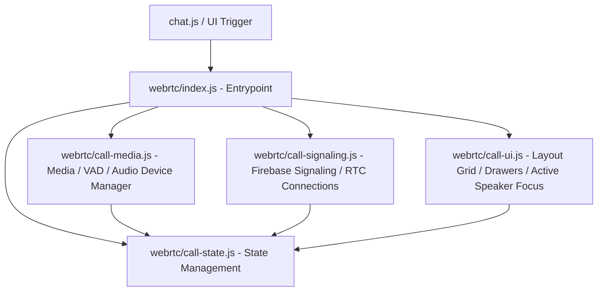

# Implementation Plan - Production-Quality Group Voice and Video Calling

This plan outlines the design and steps to completely redesign the hotmapp group call system. It extracts global calling code from `public/chat.js` into modular files under `public/webrtc/` and builds a robust, low-latency mesh-based group calling interface supporting advanced media controls, adaptive layouts, voice activity detection, and network state recovery.

## Architectural Overview

We will separate the calling codebase into five focused files under a new `public/webrtc/` directory:

1. **`call-state.js`**: Manages dynamic call states (current active call type, participants, speaking states, mute states, connection states, logs).
2. **`call-media.js`**: Controls user media capture (audio constraints like noise suppression, echo cancellation, AGC), camera flipping, screen sharing, device selection, and Web Audio API-based Voice Activity Detection (VAD).
3. **`call-signaling.js`**: Communicates with Firebase Realtime Database to exchange offers, answers, and candidates, handles deduplication, ignores stale events, and monitors peer connection handshakes.
4. **`call-ui.js`**: Handles responsive grid calculation (1 to 9+ participants), participant details overlay (mic/camera badges, name tag, voice activity outline, latency metrics), the options sheet, PIP, and minimization.
5. **`index.js`**: Integrates the submodules, exposes standard hooks (`startVoiceCall`, `startVideoCall`, `endCall`, etc.), and binds DOM events.

---

## User Review Required

> [!IMPORTANT]
> - **Mesh WebRTC Network Scale**: Because this is a peer-to-peer mesh WebRTC architecture, bandwidth and CPU consumption grow quadratically with the number of group participants ($O(N^2)$). We will optimize this by dynamically lowering video resolution/bitrate for high-count calls (5+ participants) and disabling video rendering when off-screen.
> - **Browser Auto-Play Restrictions**: Browsers restrict programmatic audio play without user interaction. When auto-accepting group invitations, we will queue media playback and display a user-friendly trigger if the browser blocks auto-play.

---

## Open Questions

None at this time. All requirements fit the existing database structure and UI layout targets.

---

## Proposed Changes

### 1. Database Helper & Signaling

#### [MODIFY] [database-service.js](file:///c:/Users/USER/OneDrive/Desktop/hotmapp/public/database-service.js)
* Import/export logic will be preserved.
* We will verify the existing signatures of call signaling functions to ensure backwards compatibility.

---

### 2. Modular WebRTC System

#### [NEW] [call-state.js](file:///c:/Users/USER/OneDrive/Desktop/hotmapp/public/webrtc/call-state.js)
* Keeps track of the live session state:
  * `sessionId`: Unique call identifier.
  * `participants`: Map of peer UID to their metadata (display name, avatar, mic/cam states, volume level, connection state).
  * `peerConnections`: Map of peer UID to `RTCPeerConnection`.
  * `localStream` and `screenStream`.
  * Controls like camera muted, microphone muted, speaker enabled.

#### [NEW] [call-media.js](file:///c:/Users/USER/OneDrive/Desktop/hotmapp/public/webrtc/call-media.js)
* **Audio Constraint Toggles**: Noise suppression (`noiseSuppression`), echo cancellation (`echoCancellation`), and automatic gain control (`autoGainControl`).
* **Audio Device Enumeration**: Enumerate and select input/output devices.
* **Voice Activity Detection**: Initialize a Web Audio `AudioContext` and `AnalyserNode` on the local audio stream. Calculate root-mean-square (RMS) level. Trigger a debounce-speaking event when a threshold is crossed to highlight the participant.
* **Camera Facing Mode**: Handle swapping between front/rear cameras natively and mirror the local preview for front camera feed.

#### [NEW] [call-signaling.js](file:///c:/Users/USER/OneDrive/Desktop/hotmapp/public/webrtc/call-signaling.js)
* Handles peer connection handshakes.
* Implements **signaling deduplication**: compares incoming SDPs and state timestamps to ignore duplicate triggers.
* Implements **stale invitation filtering**: compares call start times to discard calls older than 60 seconds.
* Implements **reconnection & ICE restart**: automatically triggers an ICE restart on `iceconnectionstatechange` to restore connections on network switches.

#### [NEW] [call-ui.js](file:///c:/Users/USER/OneDrive/Desktop/hotmapp/public/webrtc/call-ui.js)
* **Dynamic Grid Render**: Renders grid layouts tailored to the active participant count:
  * *1-2 peers*: Main/PIP swap or 50/50 vertical.
  * *3-4 peers*: Quad 2x2 grid.
  * *5-8 peers*: 2x3 or 2x4 grid.
  * *9+ peers*: Grid focusing on the active speaker + thumbnail scroll list.
* **Participant Badge**: Render badges on each video card: mic status, speaker glow, connection stability indicator.
* **Active Speaker Focus**: Visually highlights the speaker card with a smooth, non-flickering border animation.

#### [NEW] [index.js](file:///c:/Users/USER/OneDrive/Desktop/hotmapp/public/webrtc/index.js)
* Exposes public methods and attaches event listeners to the controls layout in `index.html`.

---

### 3. Application Integration

#### [MODIFY] [chat.js](file:///c:/Users/USER/OneDrive/Desktop/hotmapp/public/chat.js)
* Remove legacy global call variables and inline WebRTC operations.
* Delegate voice/video call buttons and incoming database signaling to the new `webrtc/index.js`.

---

## Verification Plan

### Automated Tests
- Run `npm test` to verify that existing cache manager and service helper tests still execute correctly.

### Manual Verification
1. **Starting/Joining Calls**: Validate voice and video calls start and establish between two clients.
2. **Multiple Participants (Group)**: Simulate 3-4 users joining the same group call. Verify the video layout dynamically adjusts to a quad layout.
3. **Voice Activity Detection**: Speak on one device and verify that its corresponding participant card glows green.
4. **Mute/Cam Mute Toggles**: Verify audio/video streams stop and badge indicators update instantly for other participants.
5. **Network Disruption Recovery**: Disconnect Wi-Fi and verify the connection switches to cellular/reconnects using ICE restart.
